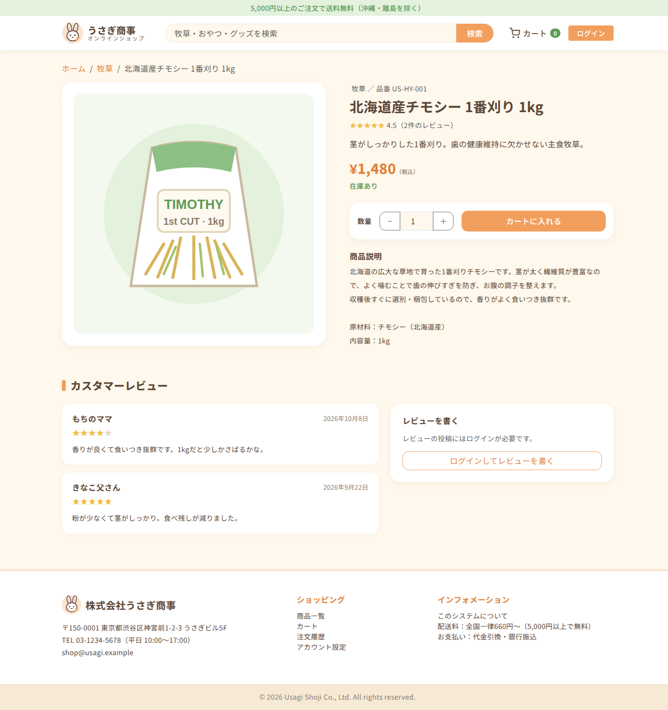
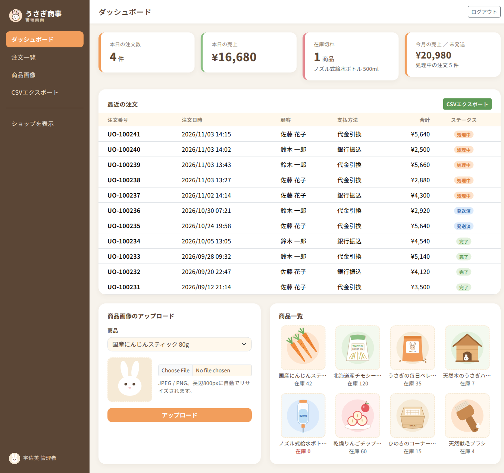

# うさぎ商事 オンラインショップ / Usagi Shoji Online Shop

株式会社うさぎ商事の、うさぎ用品を扱う小さな EC サイトです。PHP 8.2（フレームワークなし）+ Apache mod_php + MySQL 8 で動作します。

A small e-commerce site for rabbit supplies, built with plain PHP 8.2, Apache mod_php and MySQL 8.


## 起動方法 / Getting started

```bash
docker compose up -d
```

| URL | 内容 / What |
| --- | --- |
| http://localhost:8080 | ショップ / Shop |
| http://localhost:8080/admin/ | 管理画面 / Admin |
| http://localhost:8025 | Mailhog（注文確認メール / order mails） |

初回起動時に Composer の依存関係インストールと DB の初期データ投入が自動で行われます。
On first start, Composer dependencies are installed and the database is seeded automatically.

## テスト用アカウント / Test accounts

テスト用アカウントは `APP_ENV=development` で起動したときだけ有効になり、ログイン画面と /about.php にも表示されます。
Test accounts are enabled (and listed on the login and about pages) only when started with `APP_ENV=development`.

```bash
APP_ENV=development docker compose up -d
```

パスワードはすべて `password` / All passwords are `password`.

| メール / Email | 権限 / Role |
| --- | --- |
| `admin@usagi.example` | 管理者 / Admin |
| `user1@usagi.example` | 一般会員（佐藤 花子）/ Customer |
| `user2@usagi.example` | 一般会員（鈴木 一郎）/ Customer |

## 本番環境 / Production

`APP_ENV` を指定しない（既定値 `production`）場合、初期データのアカウントはログインできない状態で作成されます。管理者のパスワードは、DB の初回初期化前に `ADMIN_PASSWORD_HASH` で設定してください。
Without `APP_ENV` (default `production`), seeded accounts are created locked. Set the admin password with `ADMIN_PASSWORD_HASH` before the database is first initialized.

```bash
docker compose run --rm --no-deps web php -r 'echo password_hash(trim(fgets(STDIN)), PASSWORD_DEFAULT), PHP_EOL;'
# .env に一重引用符で追記 / add to .env in single quotes:
# ADMIN_PASSWORD_HASH='$2y$10$...'
```

既存の DB で管理者パスワードが `password` のままの場合は、すぐにアカウント画面から変更してください。
If an existing database still has the admin password `password`, change it from the account page immediately.

## テスト / Tests

```bash
tests/smoke.sh                                   # curl smoke test (stack must be running with APP_ENV=development)
docker run --rm -v "$PWD":/app -w /app composer:2 \
  sh -c "composer install -q && vendor/bin/phpunit"   # PHPUnit unit tests
```

## スクリーンショット / Screenshots

| 商品詳細 / Product | 管理画面 / Admin |
| --- | --- |
|  |  |

その他の画面は [`docs/screenshots/`](docs/screenshots/) を参照してください。 / More in `docs/screenshots/`.
